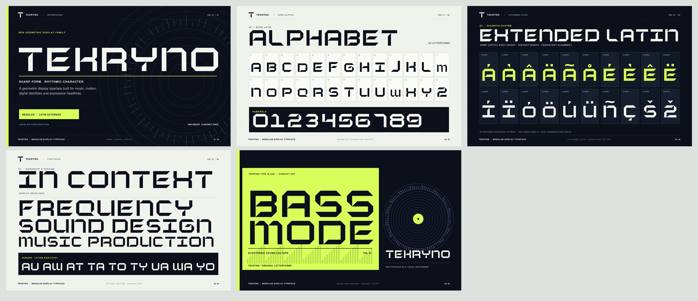

# Tekryno

**Tekryno** is an original geometric, angular, futuristic display typeface designed by **Shrawan Gaikwad**. Its letterforms take inspiration from electronic music and modular shapes. Uppercase and lowercase input intentionally display uppercase-style designs.

**Status:** Public OFL-1.1 release candidate and editable source repository. **Tekryno has not yet been submitted to or accepted by Google Fonts.**

## Font family

- Menu family: **Tekryno**
- Style: **Regular**
- OpenType PostScript name: **Tekryno-Regular**
- Glyphs: **218**; Unicode mappings: **327**
- Required GF Latin Core codepoints: **319 of 319 present**
- Specimen branding: **TEKRYNO**

## Download and sources

- [TrueType font](fonts/ttf/Tekryno-Regular.ttf)
- [CFF OpenType font](fonts/otf/Tekryno-Regular.otf)
- [Editable UFO source](sources/Tekryno-Regular.ufo)
- [Illustrator SVG artwork archive](sources/original-svg-archive/)
- [OpenType feature source](sources/features.fea)
- [Build helper](sources/build_from_ufo.py)
- [Five-page vector specimen](documentation/specimen/Tekryno-Type-Specimen.pdf)
- [Font license](OFL.txt)

The font is licensed under **SIL Open Font License 1.1, with no Reserved Font Name**. Copyright 2026 The Tekryno Project Authors (https://github.com/sgproductionindia/tekryno). The original designer is Shrawan Gaikwad. The entire family is open source, not just the Regular style.

## Google Fonts review

The official Fontspector Google Fonts profile was executed on the TTF in a correctly named `tekryno` directory on 2026-11-26:

**109 PASS, 0 FAIL, 10 WARN, 11 INFO, 83 SKIP.**

- [Full Fontspector report](documentation/FONTSPECTOR-REPORT.md)
- [Design-aware warning review](documentation/QA-REVIEW.md)
- [Official Latin Core coverage check](documentation/LATIN-CORE-COVERAGE.md)
- [Source provenance and rebuild caveat](documentation/PROVENANCE.md)
- [Current submission checklist](documentation/SUBMISSION-CHECKLIST.md)
- [Draft proposal for Google Fonts](documentation/GOOGLE-FONTS-PROPOSAL-DRAFT.md)

**Source reproducibility caveat:** The latest UFO development build retains the approved TTF's glyph count, Unicode mappings and metrics, but one dotted-circle outline and compiled GPOS bytes differ. The approved release binary remains the visual reference while these differences are reviewed.

Google Fonts publication is subject to independent design review, source and engineering validation, and the author's Contributor License Agreement. Technical checks passing does **not** imply acceptance.

Guide: https://googlefonts.github.io/gf-guide/onboarding.html
