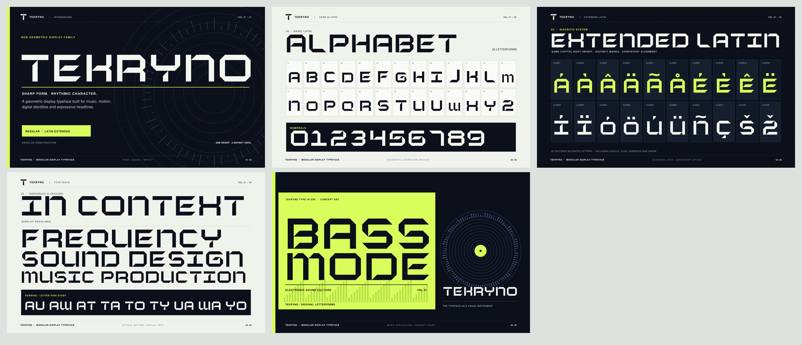

# Google Fonts Add Font issue — Tekryno (ready to paste)

> **Status:** Prepared submission draft. **Not yet posted** to `google/fonts`. The connected GitHub integration cannot create issues in that upstream repository (403). Open the official [Add Font form](https://github.com/google/fonts/issues/new?template=1_add-font.md&title=Add%20Tekryno), paste the issue body below, review the unchecked attestations, and submit using your GitHub account.

**Issue title:** Add Tekryno

---

**Font Project Git Repo URL:**

https://github.com/sgproductionindia/tekryno

**Super short description of the Font Family:**

Tekryno is an original geometric display typeface designed by Shrawan Gaikwad. Its angular, modular letterforms are inspired by electronic music and futuristic visual design, intended for posters, branding, music artwork and headlines. Lowercase characters intentionally share uppercase-style forms.

**Requirements:**

- [x] The entire font project is available in a public GitHub repository and licensed under the SIL Open Font License 1.1.
- [ ] I confirm no paid, proprietary or larger "Plus"/"Pro" family exists. *(Original author to verify before checking.)*
- [x] The editable font sources (UFO and original Illustrator SVGs) are available in the repository.
- [x] The original author has confirmed ownership/necessary rights to the designs and licensed them under OFL. **AI use disclosure:** The author drew the letterforms in Illustrator. AI-assisted development was used to help with Python font compilation, documentation, naming and QA; the glyph outlines are based on the author's own artwork.
- [x] The license declares no Reserved Font Names.
- [ ] The name is unique according to [fontdata namecheck](https://namecheck.fontdata.com/). *(Complete the dedicated name check; initial web searches found no obvious matching typeface, which is not definitive clearance.)*
- [x] The menu family name is **Tekryno**, style **Regular**; PostScript name **Tekryno-Regular**.
- [x] Encoded coverage includes all 319 required GF Latin Core codepoints.
- [x] The project has the essential Google Fonts upstream structure: separate TTF/OTF directories, editable UFO master, a single-command `sources/build.sh`, README image, authors, OFL, requirements and documentation.
- [ ] All Google Fonts quality and source-reproducibility requirements have been resolved. *(See transparent note below; checks are ongoing.)*
- [ ] I will personally maintain the repository and participate in onboarding. *(Original author to confirm before checking.)*

**Image:**

**Additional project details:**

- Design source and build: https://github.com/sgproductionindia/tekryno/tree/main/sources
- TTF: https://github.com/sgproductionindia/tekryno/blob/main/fonts/ttf/Tekryno-Regular.ttf
- Five-page specimen PDF: https://github.com/sgproductionindia/tekryno/blob/main/documentation/specimen/Tekryno-Type-Specimen.pdf
- SIL OFL 1.1: https://github.com/sgproductionindia/tekryno/blob/main/OFL.txt
- Google Fonts Fontspector report: https://github.com/sgproductionindia/tekryno/blob/main/documentation/FONTSPECTOR-REPORT.md
- Design-aware QA notes: https://github.com/sgproductionindia/tekryno/blob/main/documentation/QA-REVIEW.md
- Encoded GF Latin Core: **319/319**; current Fontspector summary: **109 PASS, 0 FAIL, 10 WARN**, with 11 INFO and 83 SKIP.

**Google CLA:** The author reports that the Google Individual Contributor License Agreement was successfully submitted on 26 November 2026.

**Source build caveat:** The current editable UFO development build has the same 218 glyphs, 327 Unicode mappings and horizontal metrics as the approved TTF, but a dotted-circle outline and compiled GPOS bytes are not yet identical. This is documented and will be reconciled as part of engineering review. The font's intentionally angular geometric shapes will be preserved.

I would welcome review and any necessary technical or design feedback. Thank you for considering Tekryno for Google Fonts.
